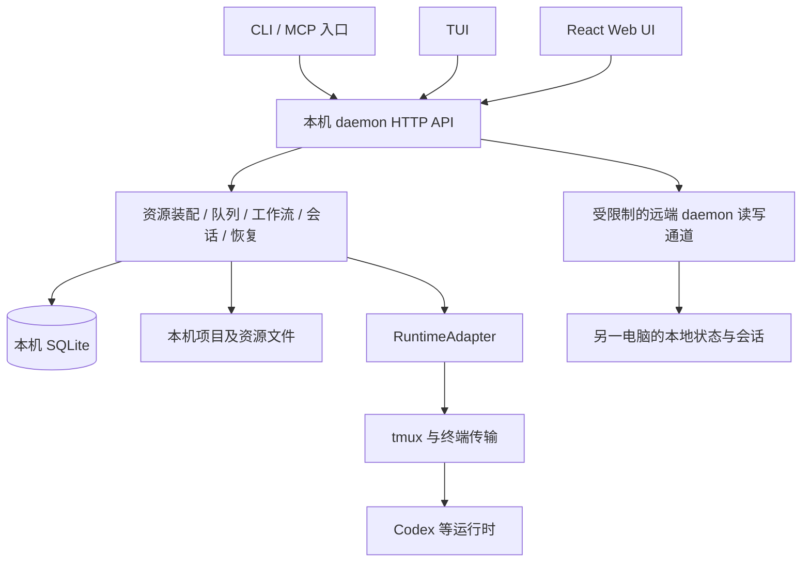
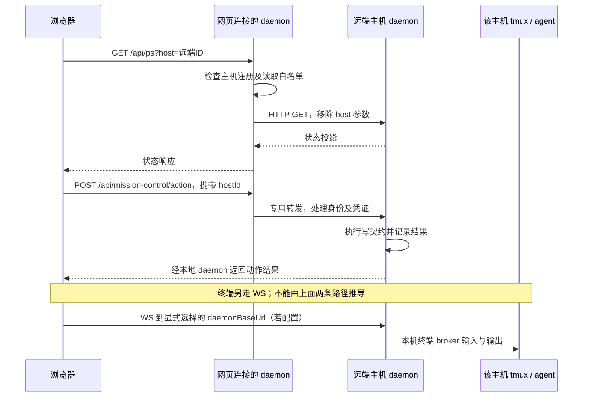
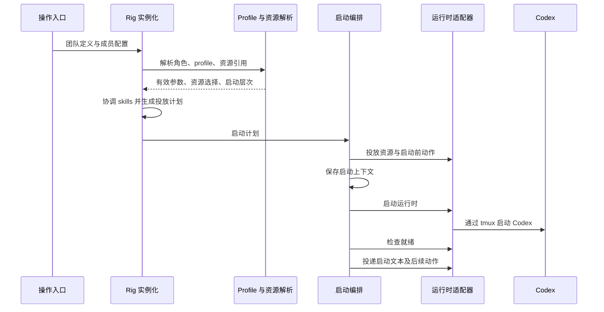

# 原始 OpenRig 架构详解

分析日期：2026-10-10（在 2026-10-09 初稿上复核更新）。代码版本：`0.6.7`。基准提交：`29c2a56104e6247d289267685264b96fac46ec2a`。

本文研究上述固定提交的 OpenRig，为后续自建研发平台提供依据。当前分支工作区已整理为新平台，本文的源码链接指向原固定提交；历史命令和路径也按该提交解释，不作为当前工作区运行入口。文中的“现状”指该提交的实现；“建议”指结合当时需求的设计判断，不代表 OpenRig 已实现，也不替代后续 SDD 规格。

## 1. 主要结论

OpenRig 的核心是**管理 agent 工作环境、执行会话和协作状态的常驻协调系统**。模型推理由 Codex、Claude Code 等外部运行时承担。OpenRig 本身不需要先成为一个 LLM agent，才能完成队列、工作流、恢复和人工介入。

它不是简单启动一条 Codex 命令：启动前会解析角色和 profile、选择资源、处理路径及冲突、投放 skills 和指导文件、合并部分配置、保存启动上下文，然后启动运行时、检查就绪并投递启动内容。

但它也不是我们设想的“中央平台统一维护所有资源，再向无状态节点下发执行包”。当前实现仍以各电脑本地 daemon、SQLite、文件系统和终端会话为基础，本机用户配置、项目目录和已有资源参与最终环境的形成。远程查看与操作不等于中央资源同步。

对自建平台最有价值的是四项设计：**执行前装配环境、稳定身份与会话分离、任务持久化与终端投递分离、交付结论与证据关联**。最不应整体复制的是 tmux 兼容层、多种终端运行时的探测规则，以及已经积累的大量 CLI/TUI 操作面。

## 2. 研究范围与证据强度

本次按“全局架构 → 网页到远端执行链路 → 规范及资源加载 → 中文入口与状态 → 证据核验”的顺序复核。重新清点跟踪文件，精读相关实现，并运行 9 个相关测试文件。初稿的全仓文本扫描及语法树结果作为历史记录保留，本次未重复执行语法树解析。

| 项目 | 本轮结果 | 含义 |
|---|---:|---|
| Git 跟踪文件 | 3,473 | 以当前提交为边界，不包含依赖目录和未跟踪需求文档 |
| 文本文件 | 3,468 | 按不含空字节的文件计；本次统计 730,018 个换行符，末行计数口径与初稿略有差异 |
| 代码与脚本文件（初稿记录） | 2,878 | `.ts/.tsx/.js/.mjs/.cjs/.py/.sh`，约 654,027 行，包含测试、夹具及生成内容；本次未重算该子集 |
| JS/TS 语法树解析（初稿记录） | 2,859 个文件，0 个语法解析诊断 | 本次未重跑；不等于类型检查或测试通过 |
| 未进行文本分析的二进制文件 | 5 | README 动图、UI 截图及图形资源 |
| 数据库迁移文件 | 96 | 表示演进历史，不是当前业务表数量 |

**“全量扫描”不等于每一行都已完成人工语义审查。** 本文是覆盖全仓库模块、重点链路深入分析的研究报告，不宣称完成逐行安全审计或所有功能的运行验证。

本次相关测试 **329/329 通过，失败 0、跳过 0**，详见第 14 节。未重跑构建、类型检查、全仓测试，也未执行真实模型调用、浏览器端到端或双机恢复演练。现有 `ARCHITECTURE.md` 标注的提交为 `c750304f`，早于本次 HEAD；涉及差异时以实现为准。全文的“源码支持”“模拟测试通过”“真实运行验证”分别表述，不相互替代。

## 3. 技术栈与包结构

| 部分 | 当前技术 | 职责 |
|---|---|---|
| daemon | Node.js、TypeScript、Hono、better-sqlite3 | HTTP API、状态持久化、资源装配、执行控制、队列、恢复 |
| CLI | TypeScript、Commander | 面向操作者与脚本的命令入口，以及 MCP 接入 |
| TUI | TypeScript、终端输入和渲染 | 在终端中查看拓扑、队列及执行状态，操作 daemon |
| Web UI | React 19、Vite 6、TanStack Router/Query/Table、Radix、Tailwind | 维护、查看、审查、人工操作、终端预览 |
| 外部执行 | Codex、Claude Code、Pi、OMP、终端等适配器 | 实际模型调用及工具执行 |
| 进程会话 | tmux、子进程、终端抓取及输入 | 启动、投递、观察和接管运行时 |
| 数据与资源 | SQLite、YAML、Markdown、TOML、目录资源 | 运行状态、团队定义、角色、skills、上下文及运行时配置 |
| 测试与构建 | Vitest、TypeScript、Node test、Shell、GitHub Actions | 包测试、仓库约束、构建、安装场景验证 |

根目录使用 npm workspaces。Node 版本约束为 `^22 || ^24`。这些版本描述仓库声明，不代表对外部软件最新版本的判断。

发布组装与开发目录不是同一件事：`scripts/build-package.sh` 将 daemon、UI、TUI 等产物组装到发布用 CLI 包，`scripts/rewrite-daemon-imports.mjs` 处理共享代码导入。因此，不能把四个 workspace 直接理解为四个独立部署服务。

源码规模也说明了重写成本：daemon/src 有 659 个 JS/TS 文件，CLI/src 有 173 个，TUI/src 有 67 个，UI/src 有 304 个。主体复杂度集中在 daemon 的领域逻辑和终端控制，不在 HTTP 框架。

来源：[根 package.json](https://github.com/mvschwarz/openrig/blob/29c2a56104e6247d289267685264b96fac46ec2a/package.json)、[daemon 依赖](https://github.com/mvschwarz/openrig/blob/29c2a56104e6247d289267685264b96fac46ec2a/packages/daemon/package.json)、[UI 依赖](https://github.com/mvschwarz/openrig/blob/29c2a56104e6247d289267685264b96fac46ec2a/packages/ui/package.json)、[打包脚本](https://github.com/mvschwarz/openrig/blob/29c2a56104e6247d289267685264b96fac46ec2a/scripts/build-package.sh)。

## 4. 总体架构与控制边界



`packages/daemon/src/index.ts` 负责进程生命周期、监听和周期任务；`startup.ts` 是依赖装配中心；`server.ts` 组织 Hono 中间件、路由、事件流、WebSocket 和静态 UI。领域服务通过仓库对象及适配器执行操作。

这属于本地常驻协调服务加领域模块的结构。数据库、队列和事件在 daemon 内组织，不依赖一个独立消息中间件来完成所有协调。SQLite 启用 WAL 和外键，迁移记录在 `schema_migrations`，按名称顺序执行，每个迁移有事务边界。

Web UI 源码仍明确采用维护界面定位，CLI 是重要操作入口。用户希望的纯中文 WebUI 主流程，需要重新组织产品交互与后端能力，不能仅把原 UI 翻译一遍。

来源：[进程入口](https://github.com/mvschwarz/openrig/blob/29c2a56104e6247d289267685264b96fac46ec2a/packages/daemon/src/index.ts)、[依赖装配](https://github.com/mvschwarz/openrig/blob/29c2a56104e6247d289267685264b96fac46ec2a/packages/daemon/src/startup.ts)、[HTTP 服务](https://github.com/mvschwarz/openrig/blob/29c2a56104e6247d289267685264b96fac46ec2a/packages/daemon/src/server.ts)、[数据库连接](https://github.com/mvschwarz/openrig/blob/29c2a56104e6247d289267685264b96fac46ec2a/packages/daemon/src/db/connection.ts)、[迁移执行器](https://github.com/mvschwarz/openrig/blob/29c2a56104e6247d289267685264b96fac46ec2a/packages/daemon/src/db/migrate.ts)、[UI 入口](https://github.com/mvschwarz/openrig/blob/29c2a56104e6247d289267685264b96fac46ec2a/packages/ui/src/App.tsx)。

### 4.1 网页访问远端：读取、写动作、终端是三条链路



图中终端直连是组件可表达的路径，不代表已验证跨机配置、浏览器访问和认证；默认终端地址仍是网页同源地址。

| 路径 | 实现与返回结果 | 边界 |
|---|---|---|
| 主机选择 | `useHosts` 读取 `/api/hosts`，选择写入 `/api/config/host.selected` | 选择状态存于 daemon 配置，不应假设每个浏览器标签页独立 |
| 远端状态读取 | `usePsEntries` 每 3 秒读取带 host 参数的 `/api/ps`；`hostReadThrough` 检查白名单并转发 | 通用读取代理只接受 GET，HTTP 主机可用，SSH 分支不支持；这不是通用远程命令代理 |
| Mission Control 写动作 | 独立 POST 路由读取 `hostId`，转发到目标 daemon 的写契约 | 不经过 GET 代理；返回动作处理结果，不证明 agent 已完成开发任务 |
| 交互终端 | `FocusedTerminal` 根据 `daemonBaseUrl` 或 `window.location.origin` 构造 WS；终端路由连接该 daemon 的本机 tmux broker | 不通过 `?host=` 自动桥接；需要另外验证远端地址、认证、网络和会话归属 |
| 生命周期操作 | `ScopePages` 对远端范围展示只读提示，不挂载本地启动/恢复操作 | 切换到远端主机不代表具备完整远端启动和恢复 UI |
| 实时刷新 | 拓扑事件使用 `/api/events` 的 EventSource，同时相关查询轮询刷新 | 固定事件入口不能单独证明所有远端事件已汇聚；轮询结果与终端输出也不是同一种证据 |

远端读代理移除 `host` 后才请求目标，防止把同一选择参数继续传递；使用约 5 秒超时。Mission Control 远端写路径使用约 10 秒超时，移除转发体中的 `hostId` 和 `actorSession`，按传输身份重新处理来源，保留结构化成功或失败结果。其他路由可能有自己的远端能力，不能用通用读取白名单推断整个系统的支持范围。

**发现的契约差异**：后端 `mission-control-action-log.ts` 定义 8 个动作，包括 `resolve`；前端 `useMissionControlAction.ts` 仍只声明 7 个，不含 `resolve`，路由顶部注释也仍写 7 个。本轮远端写测试覆盖了后端 `resolve`，但没有验证其完整网页操作。因此这里是确定的声明差异，是否存在其他专用 UI 路径及其完整体验仍需另查。

此外，`App.tsx` 将现有 UI 标为实验性维护界面，并说明 CLI 是主要支持入口。Vite 开发代理没有显式设置 `ws: true`；开发模式下的终端 WS 转发需运行验证，不能据此直接宣布故障，也不能当作已可用。自建纯 Web 平台需要自行兑现网页端完整操作能力。

来源：[主机选择](https://github.com/mvschwarz/openrig/blob/29c2a56104e6247d289267685264b96fac46ec2a/packages/ui/src/hooks/useHosts.ts)、[状态查询](https://github.com/mvschwarz/openrig/blob/29c2a56104e6247d289267685264b96fac46ec2a/packages/ui/src/hooks/usePsEntries.ts)、[读取代理](https://github.com/mvschwarz/openrig/blob/29c2a56104e6247d289267685264b96fac46ec2a/packages/daemon/src/domain/hosts/read-through.ts)、[写动作路由](https://github.com/mvschwarz/openrig/blob/29c2a56104e6247d289267685264b96fac46ec2a/packages/daemon/src/routes/mission-control.ts)、[前端动作 hook](https://github.com/mvschwarz/openrig/blob/29c2a56104e6247d289267685264b96fac46ec2a/packages/ui/src/components/mission-control/hooks/useMissionControlAction.ts)、[后端动作集合](https://github.com/mvschwarz/openrig/blob/29c2a56104e6247d289267685264b96fac46ec2a/packages/daemon/src/domain/mission-control/mission-control-action-log.ts)、[终端组件](https://github.com/mvschwarz/openrig/blob/29c2a56104e6247d289267685264b96fac46ec2a/packages/ui/src/components/terminal/FocusedTerminal.tsx)、[终端路由](https://github.com/mvschwarz/openrig/blob/29c2a56104e6247d289267685264b96fac46ec2a/packages/daemon/src/routes/terminal-ws.ts)、[终端 broker](https://github.com/mvschwarz/openrig/blob/29c2a56104e6247d289267685264b96fac46ec2a/packages/daemon/src/terminal/TerminalSessionBroker.ts)、[远端范围 UI](https://github.com/mvschwarz/openrig/blob/29c2a56104e6247d289267685264b96fac46ec2a/packages/ui/src/components/topology/ScopePages.tsx)、[拓扑事件](https://github.com/mvschwarz/openrig/blob/29c2a56104e6247d289267685264b96fac46ec2a/packages/ui/src/lib/topology-events.ts)、[UI 入口](https://github.com/mvschwarz/openrig/blob/29c2a56104e6247d289267685264b96fac46ec2a/packages/ui/src/App.tsx)、[Vite 配置](https://github.com/mvschwarz/openrig/blob/29c2a56104e6247d289267685264b96fac46ec2a/packages/ui/vite.config.ts)。

## 5. 核心概念与数据模型

| 概念 | 实际含义 | 设计价值 |
|---|---|---|
| Rig | 一组有组织关系的节点和协作配置 | 表达团队运行实例 |
| Node / Seat | 团队中稳定的逻辑位置 | 不随进程重启而改变角色身份 |
| Pod | 节点的分组与上下文层次 | 支持组级安排 |
| Edge | 节点之间的拓扑关系 | 限定和表达协作路径 |
| Session | 一次运行时会话 | 与稳定节点分离 |
| Binding | 逻辑节点与实际终端位置的绑定 | 定位 tmux pane 等执行实体 |
| Occupant tenure / generation | 某一任实际执行者的身份 | 避免旧消息投给接替者 |
| Queue item | 有归属、状态、转移记录的任务 | 区分任务责任与聊天消息 |
| Startup context | 启动时解析和投放的上下文 | 支持追溯和恢复 |
| Workflow instance | 一次工作流及步骤推进记录 | 把协作过程转成可核对状态 |
| Snapshot / continuity state | 恢复所需事实和连续性信息 | 辅助恢复判断，不是进程内存快照 |

核心建模原则是：**节点、会话、终端位置、运行时原生 thread ID 不是同一个 ID。** 同一个角色可以经历多次会话，同一个终端位置也可能被不同执行者占用。

数据库初始迁移约束节点在 rig 中的逻辑身份，并对跨 rig 的边施加约束。后续迁移逐步补充任期、上下文、工作流等能力。直接照搬全部表结构，会把 OpenRig 的历史问题一并带入新平台；应借鉴身份边界，再按实际用例建表。

来源：[数据库迁移目录](https://github.com/mvschwarz/openrig/tree/29c2a56104e6247d289267685264b96fac46ec2a/packages/daemon/src/db)、[队列仓库](https://github.com/mvschwarz/openrig/blob/29c2a56104e6247d289267685264b96fac46ec2a/packages/daemon/src/domain/queue-repository.ts)、[投递保护](https://github.com/mvschwarz/openrig/blob/29c2a56104e6247d289267685264b96fac46ec2a/packages/daemon/src/domain/seat-delivery-guard.ts)。

## 6. 从团队定义到可执行环境

### 6.1 启动调用链



`rigspec-instantiator.ts` 将声明式团队定义转成实际节点和启动安排。`profile-resolver.ts` 解析运行时、模型、工作目录以及所选资源。`projection-planner.ts` 计算资源应如何落地。`startup-orchestrator.ts` 执行投放、保存上下文、启动、就绪检查与后续投递。

顺序有实际意义：资源准备失败时不能假装已经完成启动；保存启动上下文后，后续恢复才有依据。另一方面，“运行时就绪”“启动文本已投递”“agent 已理解职责”是不同事实，源码另有启动证明机制，不能用单一 ready 状态替代所有结论。

### 6.2 参数与上下文加载规则

运行时、模型和 effort 等参数，按成员设置、profile preferences、spec defaults 的顺序选择。工作目录另有显式覆盖及成员目录的解析规则。

启动内容按以下层次组合：Agent 基础 → Profile → Rig culture → Rig startup → Pod → Member → operator 调试附加内容。文件和动作是叠加的，不能假设自动去重，重复声明可能产生重复动作。

资源池来自基础定义与 imports，还会发现项目及本机 runtime 目录、spec 自带 skills、用户目录及 OpenRig 管理的资源。显式声明和发现资源并非同等优先。最终 skill loadout 还组合系统选择、拓扑 profile 选择和项目 `project.yaml` 的 `install.skills`。

所以，**profile 中选择了哪些资源，不等于运行时只能看到这些资源**。本机配置、已有文件和运行时自身的发现规则仍然影响实际环境。

### 6.3 资源投放与冲突

投放计划区分安全投放、无需修改、受管理合并、哈希冲突、受管理旧版本覆盖、操作者修改冲突等情况。已有投放清单和来源哈希帮助区分“平台上次放的旧文件”与“后来被用户修改的文件”。

不能把实现概括成“绝不覆盖用户文件”：在缺少历史 manifest 等分支中，存在记录警告后继续覆盖的行为；不同资源类型的处理也不同。自建平台应明确文件所有权，尽量将平台生成内容放进自己的任务环境，减少依赖复杂的原地合并。

来源：[实例化](https://github.com/mvschwarz/openrig/blob/29c2a56104e6247d289267685264b96fac46ec2a/packages/daemon/src/domain/rigspec-instantiator.ts)、[Profile 解析](https://github.com/mvschwarz/openrig/blob/29c2a56104e6247d289267685264b96fac46ec2a/packages/daemon/src/domain/profile-resolver.ts)、[启动层次](https://github.com/mvschwarz/openrig/blob/29c2a56104e6247d289267685264b96fac46ec2a/packages/daemon/src/domain/startup-resolver.ts)、[投放计划](https://github.com/mvschwarz/openrig/blob/29c2a56104e6247d289267685264b96fac46ec2a/packages/daemon/src/domain/projection-planner.ts)、[启动编排](https://github.com/mvschwarz/openrig/blob/29c2a56104e6247d289267685264b96fac46ec2a/packages/daemon/src/domain/startup-orchestrator.ts)、[Skill catalog](https://github.com/mvschwarz/openrig/blob/29c2a56104e6247d289267685264b96fac46ec2a/packages/daemon/src/domain/skill-catalog.ts)。

## 7. Codex 如何实际获得 skills、MCP 和上下文

| 资源 | 当前 Codex 适配方式 | 需要注意 |
|---|---|---|
| Skills | 投放到工作目录 `.agents/skills/<id>` | 同一工作目录共享文件，不能视为每个 seat 的独占环境 |
| 角色指导 | 合并到工作目录 `AGENTS.md` 的受管理区块 | 与原有指导共存，仍受实际加载规则影响 |
| Subagents | 投放到工作目录 `.agents/` | 资源存在和实际被调用是两个事实 |
| Plugins | 投放到 `.codex/plugins/<id>`；插件 skills 另行投放 | 不能假设运行时会自动发现任意目录中的插件 skills |
| Codex 配置片段 | 合并到 `$CODEX_HOME/config.toml`，默认用户目录 | 未天然按项目或 seat 隔离 |
| MCP 配置 | 通过运行时配置资源进入配置 | 不等于 MCP 服务已启动、可达或已经授权 |
| 启动文本 | tmux 输入与提交 | 本实现不是 Codex app-server JSON-RPC 控制链路 |
| 活动 Hooks | 特定的 OpenRig 活动观测 hook 配置 | 适配器还有专门的安装与信任处理 |

Codex 配置片段要求 TOML 表头；受管理片段与用户已有表冲突时保留用户表，重复的受管理表不写入。这尊重本机设置，但也意味着同一平台定义在不同电脑上可能形成不同有效配置。

插件 skills 提取存在警告后继续的分支，例如无法投放时记录 `plugin_skills_not_projected`，已有非平台所有的同名 skill 可能保留。平台若要求一个 SOP 必需具备某项能力，必须另有就绪判定，不能把进程启动成功当作能力齐备。

Hooks 也不是一个通用的 `uses.hooks` 资源集合。普通 hook 能力主要随插件组织；Codex 适配器对自身活动 hooks 有额外逻辑，包括写入配置及相应的 `trusted_hash`。这是 OpenRig 特定实现，不能推导成所有 hook 已获用户授权，更不应直接复制成任意 hook 的自动信任机制。

还要区分两种 MCP：**OpenRig 对 agent 暴露的管理工具**，以及 **agent 执行任务需要连接的外部 MCP 服务**。前者帮助 agent 操作团队和队列；后者属于运行环境依赖，管理和验证方式不同。

来源：[Codex 适配器](https://github.com/mvschwarz/openrig/blob/29c2a56104e6247d289267685264b96fac46ec2a/packages/daemon/src/adapters/codex-runtime-adapter.ts)、[适配器契约](https://github.com/mvschwarz/openrig/blob/29c2a56104e6247d289267685264b96fac46ec2a/packages/daemon/src/domain/runtime-adapter.ts)、[Agent spec 说明](https://github.com/mvschwarz/openrig/blob/29c2a56104e6247d289267685264b96fac46ec2a/docs/reference/agent-spec.md)。

### 7.1 加载链路的实际顺序与隔离边界

复核 `startup-orchestrator.ts` 的实现，顺序是资源投放 `adapter.project` → 启动前投递 → 持久化 `node_startup_context` → `launchHarness` → 就绪检测及启动后投递。应以这些调用为依据，不能直接把文件顶部概述当成当前精确时序。启动上下文先落库，有助于记录后续启动失败；落库本身不是执行成功。

`profile-resolver.ts` 分别处理运行时、模型、effort 的覆盖优先级；工作目录优先使用显式 `cwdOverride`，否则解析成员目录。`startup-resolver.ts` 组合的启动文本层次，与 Codex 自身的 `AGENTS.md` 发现规则是两回事。项目规范、角色指导、技能选择和本机运行时配置共同形成环境，不能用单个 profile 文件解释全部来源。

Codex 适配器允许显式传入 `CODEX_HOME`，因此“默认共享用户配置”不等于“技术上无法隔离”。准确结论是：当前默认路径不自动提供每项目或每 seat 的独立配置；若使用独立目录，还要核验认证、插件、MCP、hooks 和恢复行为。本文不将隔离目录方案视为已落地。

此次核对的 Codex 启动与投递路径依赖 tmux。文件中出现的 `app-server` 字样属于上游 hook 测试的注释引用，不能据此认定 OpenRig 已通过 app-server 控制 Codex。自建平台采用 app-server 仍需要单独的协议验证。

资源验证应区分四个事实：文件已投放、运行时已加载、任务实际调用、调用产生可核对结果。本次资源测试主要证明解析及投放规则，没有证明所有技能或外部 MCP 已在真实 Codex 中生效。用户既有 hook 与 OpenRig 安装的活动 hook 也要分别审查，前者失败不能简单归因为后者。

来源：[启动实现](https://github.com/mvschwarz/openrig/blob/29c2a56104e6247d289267685264b96fac46ec2a/packages/daemon/src/domain/startup-orchestrator.ts)、[参数解析](https://github.com/mvschwarz/openrig/blob/29c2a56104e6247d289267685264b96fac46ec2a/packages/daemon/src/domain/profile-resolver.ts)、[启动文本解析](https://github.com/mvschwarz/openrig/blob/29c2a56104e6247d289267685264b96fac46ec2a/packages/daemon/src/domain/startup-resolver.ts)、[Codex 环境与路径处理](https://github.com/mvschwarz/openrig/blob/29c2a56104e6247d289267685264b96fac46ec2a/packages/daemon/src/adapters/codex-runtime-adapter.ts)。

## 8. 上下文、项目与多项目隔离

OpenRig 的项目目录与 workspace catalog 记录项目 ID、根目录和关联 rig。项目注册会检查同 ID 不同目录、同目录不同 ID、rig 已关联其他项目等冲突，并尽量保留已有目录和 catalog 内容。这解决的是项目定位和关联，不是完整的任务沙箱。

Context pack 由 composer 根据场景和资源依赖组合。fresh、handover、post-compaction 有不同选择规则；来源区分 library、project、seat、mission。它估算 token 预算并给出可裁剪项，而不是默默截断所有超预算内容。

多项目隔离有三个层次：

1. **业务身份隔离**：任务属于哪个项目、团队和节点。
2. **文件与运行配置隔离**：cwd、工作树、skills、MCP 配置、环境变量是否共享。
3. **模型会话隔离**：thread、恢复来源和上下文是否对应当前任务。

OpenRig 对第一层和会话身份做了大量工作，第二层仍依赖本机目录和配置安排。给项目不同 ID，不会自动消除共享 `CODEX_HOME`、相同 cwd 或用户级 skills 带来的影响。

因此，对“三至四个项目并行不混淆”的需求，应验证实际生效环境，而不只验证数据库中的 `project_id`。至少要能核对任务的项目根目录、资源版本、有效配置和 Codex thread 对应关系。

来源：[项目注册](https://github.com/mvschwarz/openrig/blob/29c2a56104e6247d289267685264b96fac46ec2a/packages/daemon/src/domain/workspace/project-registration.ts)、[Workspace 模块](https://github.com/mvschwarz/openrig/tree/29c2a56104e6247d289267685264b96fac46ec2a/packages/daemon/src/domain/workspace)、[上下文组合](https://github.com/mvschwarz/openrig/blob/29c2a56104e6247d289267685264b96fac46ec2a/packages/daemon/src/domain/context-packs/profile-composer.ts)。

## 9. 队列、事件与可靠投递

### 9.1 任务持久化与执行是分开的

QueueRepository 管理创建、领取、移交、阻塞、完成、拒绝和取消等操作。创建任务会在事务中写任务记录、转移及事件；部分路径同事务记录唤醒意图，提交后再尝试唤醒目标。

这意味着 API 返回创建成功首先说明任务已被接收和持久化，**不证明目标终端已收到，更不证明任务已执行**。界面需要保留这些差异。

重复 qitem ID 并非无条件覆盖：同来源和目标的重试可返回已有条目；正文差异可能记录 `qitem_body_not_saved`；身份冲突则报错。它提供的是有条件的幂等行为，不能理解成任意重复请求都会更新任务。

任务结束还关注责任归属：移交、阻塞、拒绝、取消、升级等都需要明确结局，避免工作从一个节点消失，却没有任何节点继续承担。

### 9.2 防止把消息投给错误的人

SeatDeliveryGuard 对同一节点的投递操作串行化，在等待前捕获节点、session、occupant generation、pane 等身份，并在真正操作前重查。

这是 tmux 场景非常实际的问题：消息入队时 pane 中是执行者 A，投递时可能已经换成 B。只检查 pane 仍存在会造成误投。生命周期操作和输入操作之间也必须协调，避免在粘贴与提交之间切换会话。

Python 节点即使采用 app-server，也仍有类似问题：旧任务的异步回调不能更新新运行实例。可借鉴“执行尝试身份”，不必照搬所有终端锁结构。

### 9.3 事件是持久日志，不是整个系统的唯一状态源

EventBus 先保存事件再通知订阅者，支持单调序号和回放，并隔离订阅者异常。事务内事件通知有与提交配合的机制，避免向外发布尚未提交的事实。

但业务仓库表仍是重要事实来源，这不是仅靠事件日志重建所有业务状态的完整 Event Sourcing 架构。自建平台可以保留业务表加事件流水的朴素设计。

来源：[队列仓库](https://github.com/mvschwarz/openrig/blob/29c2a56104e6247d289267685264b96fac46ec2a/packages/daemon/src/domain/queue-repository.ts)、[投递保护](https://github.com/mvschwarz/openrig/blob/29c2a56104e6247d289267685264b96fac46ec2a/packages/daemon/src/domain/seat-delivery-guard.ts)、[事件总线](https://github.com/mvschwarz/openrig/blob/29c2a56104e6247d289267685264b96fac46ec2a/packages/daemon/src/domain/event-bus.ts)、[终端传输](https://github.com/mvschwarz/openrig/blob/29c2a56104e6247d289267685264b96fac46ec2a/packages/daemon/src/domain/session-transport.ts)。

## 10. 工作流、人工确认与交付审查

### 10.1 工作流引擎不是模型 agent

OpenRig 已有基于工作流定义、实例、步骤轨迹、frontier 和 gates 的推进机制。步骤完成与后继任务创建通过领域代码及事务协同，不依赖 LangChain/LangGraph 来解释全部业务状态。

这证明当前需求中的确定性 SOP 可以由普通后端代码编排。模型负责执行需要推理的步骤，平台负责记录步骤是否具备继续条件。已有 workflow 能力也不代表用户的十个 dev-* SOP 已经被迁移，应逐项映射业务行为及人工决策点。

### 10.2 人工确认有不同对象

Mission Control 可对待人工处理的工作项做决定，记录决策并更新队列，然后尝试通知执行者。这种业务决策与 Codex 原生工具权限确认不是同一类操作。

例如，“同意这份设计继续实施”属于 SOP 审批；“允许本次命令访问某资源”属于运行时权限；“终端出现信任提示”又需要运行时适配。统一展示可以，但后端必须知道确认针对哪个对象，不能所有按钮都变成向终端发送 Enter。

### 10.3 审查视图由事实组合

review 模块将磁盘、任务、Git 及证据输入组合成审查结构，核心 composer 尽量保持纯函数。它区分 INTENT、PLAN、DELIVERED，并将验证结论关联到证据和候选提交等字段。

存在一个证明文件，不自动意味着验证通过；缺失或不合法的 verdict 不应被渲染成成功。这个原则适合我们的交付审查：WebUI 应展示产物、差异、测试证据和人工意见，而不能仅显示 agent 的“完成了”。

来源：[工作流运行时](https://github.com/mvschwarz/openrig/blob/29c2a56104e6247d289267685264b96fac46ec2a/packages/daemon/src/domain/workflow-runtime.ts)、[工作流投影](https://github.com/mvschwarz/openrig/blob/29c2a56104e6247d289267685264b96fac46ec2a/packages/daemon/src/domain/workflow-projector.ts)、[人工控制模块](https://github.com/mvschwarz/openrig/tree/29c2a56104e6247d289267685264b96fac46ec2a/packages/daemon/src/domain/mission-control)、[审查组合](https://github.com/mvschwarz/openrig/blob/29c2a56104e6247d289267685264b96fac46ec2a/packages/daemon/src/domain/review/compose.ts)、[证据模块](https://github.com/mvschwarz/openrig/tree/29c2a56104e6247d289267685264b96fac46ec2a/packages/daemon/src/domain/proof)。

## 11. 恢复与持续运行

恢复不是读取一行状态后重新启动命令。`restore-orchestrator.ts` 会结合快照、当前活跃执行者、恢复策略和启动上下文，决定 resume、fresh、fork 或需要人工处理，并拒绝某些会覆盖活跃会话的恢复。

其中至少有三种连续性：任务仍在数据库中、终端进程仍在运行、运行时原生对话可以继续。三者不保证同时成立。

原生会话恢复也不等于外部命令的 exactly-once 执行。网络断开时，命令可能已执行但结果尚未回报；重新提交原请求可能重复产生副作用。自建节点第一版必须识别“结果未知”，而不是统一标成失败然后重跑。

OpenRig 为终端环境积累了恢复、补偿、探测和重试逻辑。我们使用结构化 app-server 协议有机会减少终端猜测，但 daemon 重启后的执行身份核对、事件补报和人工处理仍不能省略。

来源：[恢复编排](https://github.com/mvschwarz/openrig/blob/29c2a56104e6247d289267685264b96fac46ec2a/packages/daemon/src/domain/restore-orchestrator.ts)、[运行时契约](https://github.com/mvschwarz/openrig/blob/29c2a56104e6247d289267685264b96fac46ec2a/packages/daemon/src/domain/runtime-adapter.ts)、[终端传输](https://github.com/mvschwarz/openrig/blob/29c2a56104e6247d289267685264b96fac46ec2a/packages/daemon/src/domain/session-transport.ts)。

## 12. 多机模式与安全模型

OpenRig 的跨机模式是多个 daemon 各自持有本地状态，通过已登记的主机信息及指定接口访问其他 daemon。它不是一套共享 MySQL 的中央调度服务。

`hosts/read-through.ts` 对 `?host=` 读取实行 allowlist，只转发允许的 GET 路径，移除转发参数、由服务端附加凭证，并设超时。非 GET 不走这条通用读代理。写操作存在其他明确通道，例如 Mission Control、transport 和队列转发，所以也不能说跨机只支持读取。

这些机制没有自动解决资源版本下发、节点缓存、项目代码准备和凭证分配。那是未来中央平台需要显式承担的新职责。

安全设计主要面向可信本机或可信网络中的操作者。Bearer 中间件、绑定地址校验和浏览器 Host/Origin 边界是不同层次；Bearer 的覆盖取决于实际挂载路由，不能推断所有 API 都有统一用户授权。

特别需要以实现为准：`assertBindAuthInvariant` 对 loopback 及识别为 Tailscale 的地址允许无 bearer，一般 LAN/公开绑定才要求 bearer。文件顶部的早期注释比当前逻辑更保守。该信任模型不能直接作为未来中央平台的账号及节点授权模型。

浏览器边界用于限制目标主机名和 Origin，并不是完整用户身份体系。源码也明确指出不携带 Origin 的跨站 GET/HEAD 仍有边界限制。本文没有进行漏洞复现，不将这些设计边界直接标为已证实漏洞。

来源：[远端读取](https://github.com/mvschwarz/openrig/blob/29c2a56104e6247d289267685264b96fac46ec2a/packages/daemon/src/domain/hosts/read-through.ts)、[主机模块](https://github.com/mvschwarz/openrig/tree/29c2a56104e6247d289267685264b96fac46ec2a/packages/daemon/src/domain/hosts)、[Bearer 与绑定检查](https://github.com/mvschwarz/openrig/blob/29c2a56104e6247d289267685264b96fac46ec2a/packages/daemon/src/middleware/auth-bearer-token.ts)、[浏览器边界](https://github.com/mvschwarz/openrig/blob/29c2a56104e6247d289267685264b96fac46ec2a/packages/daemon/src/middleware/browser-boundary.ts)。

## 13. 其他模块的定位

| 模块 | 分析定位 | 对自建平台的意义 |
|---|---|---|
| CLI / TUI | 多种管理操作和本地交互入口，依赖 daemon 并保留部分本地动作 | 可参考操作能力，当前不复制交互形态 |
| Web UI | 拓扑、队列、会话预览、fleet、mission/slice 审查等页面 | 参考信息组织，按 Vue3 和中文主流程重做 |
| Gateway | Slack 等外部消息接入、线程关系、人类身份及投递 | 当前 WebUI 主流程不依赖它 |
| Provider / model divergence | 供应商及模型配置、运行时差异处理 | 第一版只支撑选定 Codex 链路 |
| Workspace / scope / slices | 项目定位、工作范围、交付单元和文档元数据 | 借鉴任务与产物关联，不原样移植目录规范 |
| Policies / steering / progress | 行为策略、人工干预、进度与注意事项投影 | 先实现真实 SOP 所需行为 |
| Bundles / spec validation | 打包、安装、来源及声明校验 | 借鉴资源来源和内容校验，不先做完整插件市场 |
| Terminal / preview | 输入、捕获、预览、状态探测及节流 | app-server 场景重新设计，避免复制终端猜测代码 |
| Scripts / CI | 打包、资源镜像、文档和 spec 检查、安装验证 | 体现发布产物也要测试的原则 |
| Assets / specs / skills | 内置团队、角色、指导和能力资源 | 是系统行为的一部分，不应只分析 `.ts` 文件 |

这一轮外围模块按目录、入口、类型、依赖和代表实现进行检查；深入程度低于启动、资源装配、投递和恢复链路。它们不能据此被视为已逐分支验证。

### 13.1 中文界面的入口与状态来源

对 `packages/ui/src` 和 UI 的 `package.json` 定向检索 `i18next`、`react-intl`、`lingui`、`locales`、`translations`，未发现匹配。这个结果仅说明检查范围内没有对应实现证据，不代表对全仓所有本地化机制的排除证明。现有文字分散在组件、错误响应和运行时输出中。

| 文字或状态 | 源码入口 | 中文处理要点 |
|---|---|---|
| 主导航和无障碍标签 | `AppShell.tsx`，桌面及移动布局均有文字 | 页面标题、按钮、空态和 aria 标签都需覆盖 |
| 实验性说明及维护入口 | `App.tsx` | 按自建平台的真实能力重新写，不能直接翻译后宣称功能完整 |
| 远端只读提示 | `ScopePages.tsx` | 保留实际能力限制，不能翻译成“远端可操作” |
| 生命周期及活动状态 | daemon `ps-projection.ts` → `/api/ps` → UI 查询与页面 | 保留机器状态码，在展示层映射中文 |
| 动作失败 | `useMissionControlAction.ts` 读取后端 `message`、`error` 或 HTTP 状态 | 中文用户提示与原始错误详情分开，避免只翻译静态按钮 |
| 终端内容 | `FocusedTerminal.tsx` 与实际运行时输出 | 应提供中文解释；不能任意替换协议、命令或就绪探测依赖的原始文本 |
| 角色及 SOP 指导 | spec、Markdown、AGENTS 和 skills | 中文提示词属于执行资源，需独立验证语义，不属于 UI 文案替换 |

状态语义尤其不能误译：`runningCount` 表示存活运行数量，`activeCount` 表示活动数量，`hasWorkCount` 表示有工作项数量；`idle` 是“空闲”，不是“已完成”；`attention_required` 或 “needs you” 是“需要处理”，可能是启动阻塞、输入请求或其他原因，不一定是权限审批。交付是否完成，应回到任务转移、审查和证据记录，不能由终端是否忙碌推断。

按照当前 [原始需求](../01-需求文档/原始需求文档.md)，这些入口用于提取中文业务语义和验证场景；新平台使用 Vue3/TDesign，不在本轮另建一套长期维护的 React 汉化层。当前最小范围是中文项目与任务主流程、节点及执行状态、失败恢复提示和 SOP 资源说明，不增加翻译管理平台。

来源：[导航与布局](https://github.com/mvschwarz/openrig/blob/29c2a56104e6247d289267685264b96fac46ec2a/packages/ui/src/components/AppShell.tsx)、[状态投影](https://github.com/mvschwarz/openrig/blob/29c2a56104e6247d289267685264b96fac46ec2a/packages/daemon/src/domain/ps-projection.ts)、[状态查询](https://github.com/mvschwarz/openrig/blob/29c2a56104e6247d289267685264b96fac46ec2a/packages/ui/src/hooks/usePsEntries.ts)。

## 14. 测试与工程质量分析

按各包 `test/` 下 `.test/.spec` 文件名统计，daemon 有 923 个测试文件，CLI 260 个，TUI 105 个，UI 198 个，合计 1,486 个。该数字不包含所有可能位于其他目录的测试，不是执行用例数，也不是通过数。

重点检查的测试意图包括：

| 测试文件（均位于 daemon/test） | 代表场景 |
|---|---|
| `profile-resolver.test.ts` | 基础与导入资源组合、歧义引用、成员参数优先级、工作目录覆盖 |
| `projection-planner.test.ts` | 仅投放选中资源、runtime 过滤、无需修改、旧版与人工修改冲突 |
| `codex-runtime-adapter.test.ts` | 可执行文件选择、信任提示不算就绪、指导文件更新、大文本投递 |
| `startup-orchestrator.test.ts` | 上下文保存时机、resume 行为、启动效果与 generation 对应 |
| `seat-delivery-guard.test.ts` | 粘贴提交期间身份稳定、旧 occupant 拒绝、数据库失败不继续输入 |
| `event-bus.test.ts` | 序号、先持久化后通知、回放、订阅者异常隔离 |
| `host-read-through.test.ts` | allowlist、写拒绝、未知主机、凭证转发、远端状态保留 |

CI 将构建和打包、类型检查、仓库约束、各包测试以及安装后的场景测试分开。包测试还有隔离环境和网络的安排；安装场景覆盖 daemon 重启及故障注入方向。这比只测试领域纯函数更接近实际交付风险。

一个容易遗漏的事实是：根目录 `npm test` 调用的 `test:workspaces` 包含 daemon、CLI、TUI，UI 有单独的 `test:ui`，CI 则单独安排 UI 包测试。因此不能看到根测试成功就断言 UI 也已验证。

### 14.1 本次实际执行结果

环境：2026-10-10，Asia/Shanghai；daemon 测试开始于 **13:27:34**，UI 开始于 **13:27:46**。HEAD 为文首完整提交；Node **24.21.0**、npm **11.19.0**、Vitest **3.2.4**。使用本机已有依赖，没有重建容器，`--no-cache` 不适用。

| 层次与测试文件 | 总计 | 通过 | 失败 | 跳过 |
|---|---:|---:|---:|---:|
| [daemon：codex-runtime-adapter](https://github.com/mvschwarz/openrig/blob/29c2a56104e6247d289267685264b96fac46ec2a/packages/daemon/test/codex-runtime-adapter.test.ts) | 80 | 80 | 0 | 0 |
| [daemon：host-read-through](https://github.com/mvschwarz/openrig/blob/29c2a56104e6247d289267685264b96fac46ec2a/packages/daemon/test/host-read-through.test.ts) | 17 | 17 | 0 | 0 |
| [daemon：mission-control-remote-action](https://github.com/mvschwarz/openrig/blob/29c2a56104e6247d289267685264b96fac46ec2a/packages/daemon/test/mission-control-remote-action.test.ts) | 8 | 8 | 0 | 0 |
| [daemon：profile-resolver](https://github.com/mvschwarz/openrig/blob/29c2a56104e6247d289267685264b96fac46ec2a/packages/daemon/test/profile-resolver.test.ts) | 51 | 51 | 0 | 0 |
| [daemon：projection-planner](https://github.com/mvschwarz/openrig/blob/29c2a56104e6247d289267685264b96fac46ec2a/packages/daemon/test/projection-planner.test.ts) | 19 | 19 | 0 | 0 |
| [daemon：startup-orchestrator](https://github.com/mvschwarz/openrig/blob/29c2a56104e6247d289267685264b96fac46ec2a/packages/daemon/test/startup-orchestrator.test.ts) | 98 | 98 | 0 | 0 |
| [daemon：terminal-ws-route](https://github.com/mvschwarz/openrig/blob/29c2a56104e6247d289267685264b96fac46ec2a/packages/daemon/test/terminal-ws-route.test.ts) | 18 | 18 | 0 | 0 |
| **后端小计** | **291** | **291** | **0** | **0** |
| [UI：mh2-host-level](https://github.com/mvschwarz/openrig/blob/29c2a56104e6247d289267685264b96fac46ec2a/packages/ui/test/mh2-host-level.test.tsx) | 35 | 35 | 0 | 0 |
| [UI：verb-actions-remote-host](https://github.com/mvschwarz/openrig/blob/29c2a56104e6247d289267685264b96fac46ec2a/packages/ui/test/verb-actions-remote-host.test.tsx) | 3 | 3 | 0 | 0 |
| **前端小计** | **38** | **38** | **0** | **0** |
| **执行合计（9 文件）** | **329** | **329** | **0** | **0** |

证据边界：

- 远端读取和写动作测试使用模拟远端请求；证明主机选择、路由拒绝及转发契约，不证明两台机器已连通。远端写测试的写契约也有 stub。
- 终端路由测试启动真实本机 Hono HTTP/WebSocket 服务，但 tmux 适配器是 mock；证明认证、连接及路由行为，不证明真实 Codex 终端可操作。
- UI 测试使用 jsdom、Testing Library 和模拟 fetch；不是实际浏览器端到端测试。
- Profile、投放、启动和 Codex 适配器测试验证解析、文件处理及编排分支；不等于完整真实模型执行。
- 本次只更新分析文档，无业务修复和新增测试，修复撤销型变异测试不适用。

| 未执行的验证层 | 本次状态 | 留下的限制 |
|---|---|---|
| 构建、类型检查、全仓测试 | 未重跑 | 329 项不能代表全仓工程质量 |
| 真实浏览器端到端 | 未执行 | 无网页完整操作验收结论 |
| 真实 Codex / MCP / hooks | 未执行 | 无真实资源加载及调用结论 |
| 中央容器 → Mac daemon → agent → 结果 | 未执行 | 用户目标链路仍需单独实测 |
| 双机、多项目及恢复演练 | 未执行 | 无跨机恢复和并行隔离结论 |

未执行项没有混入 runner 的“跳过 0”。初稿及此前构建记录不计入本次通过数。

复现命令（仓库根目录）：

```sh
npm exec -w packages/daemon -- vitest run test/host-read-through.test.ts test/mission-control-remote-action.test.ts test/terminal-ws-route.test.ts test/profile-resolver.test.ts test/projection-planner.test.ts test/startup-orchestrator.test.ts test/codex-runtime-adapter.test.ts --reporter=json --outputFile=/private/tmp/openrig-analysis-daemon-20261010.json
npm exec -w packages/ui -- vitest run test/mh2-host-level.test.tsx test/verb-actions-remote-host.test.tsx --reporter=json --outputFile=/private/tmp/openrig-analysis-ui-20261010.json
```

本次原始报告：`/private/tmp/openrig-analysis-daemon-20261010.json`、`/private/tmp/openrig-analysis-ui-20261010.json`；同名前缀 `.log` 文件保存执行日志。临时报告可能被系统清理，因此本文保留计数、环境、测试文件及复现命令。

来源：[测试工作流](https://github.com/mvschwarz/openrig/blob/29c2a56104e6247d289267685264b96fac46ec2a/.github/workflows/tests.yml)、[根脚本定义](https://github.com/mvschwarz/openrig/blob/29c2a56104e6247d289267685264b96fac46ec2a/package.json)、[daemon 测试目录](https://github.com/mvschwarz/openrig/tree/29c2a56104e6247d289267685264b96fac46ec2a/packages/daemon/test)。

## 15. 设计优点、代价与边界

值得借鉴的部分都有具体问题作为依据：

- 资源投放与启动解耦，使错误能在执行前暴露，并能追溯实际装配内容。
- 节点、会话及执行者任期分离，解决恢复和误投问题。
- 任务、状态转移、事件及唤醒相互区分，避免“通知发出就是执行成功”的错误模型。
- 审查从任务和证据组合，避免只相信 agent 自述。
- 构建产物与安装场景参与验证，覆盖源码测试不能代表的运行风险。

主要代价来自两个方向。第一是终端兼容：提示符、信任弹窗、忙碌状态、版本变化和会话探测都需要持续维护。第二是本地文件融合：用户配置、项目文件、内置资源和历史投放同时存在，优先级及所有权复杂，难以天然复现同一执行环境。

一些核心文件已经很大，例如 QueueRepository 接近四千行，实例化与启动装配文件超过两千行，恢复和 workflow 模块也有大量逻辑。文件长度不是缺陷证明，但提示关键变更往往涉及多个生命周期和事务边界，不能按“换个框架”估算迁移成本。

当前代码积累的是一个终端 agent 协作系统的经验。整体翻译成 Python 会复制历史复杂度；依据我们已经确定的 WebUI、Codex 和少量并行项目需求重新实现，范围更清楚。

## 16. 对自建 Python 平台的具体启示

以下为结合现有需求的建议，不是本轮批准或实施的新规格。

### 16.1 第一版职责划分

| 部分 | 第一版承担的职责 |
|---|---|
| Vue3 WebUI | 项目、标准团队、SOP、执行电脑确认、进度、人工处理与交付审查 |
| FastAPI + SQLAlchemy + MySQL | 维护资源定义及版本、项目和任务、分派记录、事件、人工决策及交付索引 |
| Python daemon | 接收任务、准备本机环境、启动并控制 Codex、回传事件、处理取消和重启后的状态核对 |
| Codex app-server | 模型会话及工具执行，通过结构化协议与 daemon 交互 |
| 本机文件及轻量记录 | 项目工作树、所需资源缓存、执行关联信息与待补报事件 |

资源可由中央管理定义和版本，但源代码工作树、运行进程、凭证和本机缓存不应因此全部挤进 MySQL。中央保存资源内容或引用及分派事实，节点负责将本次任务需要的内容落实到可运行环境。

### 16.2 执行节点必须包含环境准备

不能把节点简化为 `subprocess` 启动器。最小链路应是：

1. 领取已确定项目、团队、SOP 和资源版本的任务。
2. 确认项目根目录及工作树，解析此次需要的指导、skills、MCP 和配置。
3. 准备任务环境，记录来源和实际生效内容；必需资源缺失则返回明确错误。
4. 启动或连接 Codex app-server，将本次执行与 thread/turn 关联。
5. 回报事件；对人工审批停在对应步骤；取消时核对实际运行状态。
6. 保存产物引用、差异和验证结果；断线或重启后补报已知事实，对未知结果请求核对。

无需第一版就建立一个通用环境打包框架。可先用一份结构明确的任务配置和普通文件准备函数实现这条链路，真正出现第二种运行时再考虑抽象。

配置隔离需要实际验证，尤其是任务级 `CODEX_HOME`、MCP 配置、登录凭证和插件加载之间的关系。本文仅确认 OpenRig 的共享配置存在边界，不宣称改一个环境变量就已经解决所有 Codex 隔离问题。

### 16.3 轻量执行引擎的范围

先以单个 FastAPI 服务、MySQL 中的任务状态和事件、节点 asyncio 循环及少量本机执行记录完成闭环。第一版不因设想未来扩容而引入 Celery、Redis、分布式工作流引擎或通用适配器体系。

轻量不等于删除已经存在的断线和重复执行问题。至少区分任务已接收、准备中、执行中、等待人工和终态；用执行尝试 ID 防止旧回报污染新运行，对重复领取及回报规定明确处理方式。无需照搬 OpenRig 的全部状态种类。

业务顺序可保持“接入项目 → 选择标准团队 → 选择 SOP → 确认执行电脑 → 执行与审查”。平台可以提前展示电脑在线情况，但应在团队及 SOP 所需能力明确后再确认能否执行。

### 16.4 可以做但现在不做

- LangChain/LangGraph 或协调 agent：保留为待验证选项，当前确定性流程由普通 Python 代码承担。
- 多模型运行时适配：第一版只做 Codex 链路。
- OpenRig CLI、TUI、Node.js daemon 和 tmux 行为兼容：不作为新平台的运行依赖。
- 旧 Vault 目录和 dev-* 调用外壳永久兼容：迁移业务能力与资料，平台定义成为未来维护入口。
- 多租户、插件市场、复杂调度器与跨地域高可用：当前没有实际问题驱动，不预建。

## 17. 后续 SDD 需要验证的具体问题

进入实现规格前，应以一个项目、一台节点、一个 SOP 完成最小验证，再验证多项目并行：

| 问题 | 需要取得的证据 |
|---|---|
| 资源是否实际生效 | 同一任务的资源版本、节点落地内容和运行时实际使用情况能对应 |
| 项目是否混用上下文 | 三至四个项目并行时，cwd、资源、thread 和产物归属正确 |
| MCP 是否可用 | 选定服务可连接，失败明确暴露，凭证不会进入普通任务内容和日志 |
| 两类人工确认是否分清 | SOP 决策与运行时权限请求各有对应对象，重复点击不造成重复执行 |
| 断线后能否核对 | 节点或中央重启后可补报事件，不把未知副作用直接重跑 |
| 交付是否可审查 | 产物、代码差异、测试结果和人工结论关联到正确任务及版本 |

这些问题需要运行时证据，本次源码分析没有代替它们。当前研究能够支持的判断是：自建平台应保留 OpenRig 的环境装配和执行责任边界，以 Python 实现选定范围，无需复制其终端管理体系，也无需先引入 agent 框架。
